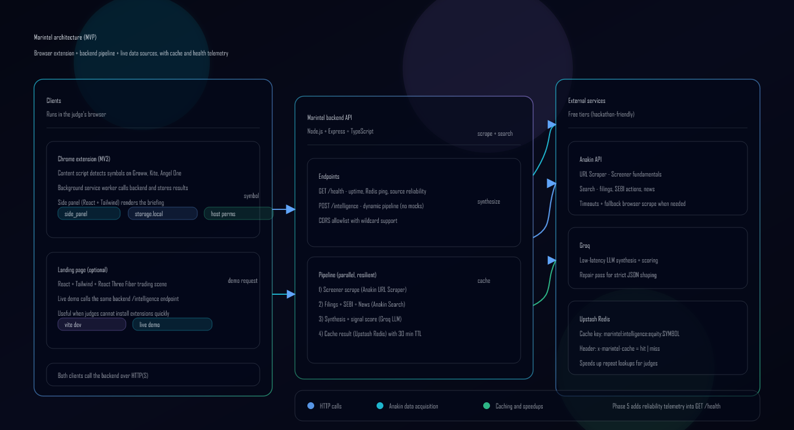

## Marintel

Zero-friction Indian equity market intelligence, delivered as a Chrome side panel.

[](./Changelog.md)
[](./backend)
[](./extension)
[](./landing)

## What problem does Marintel solve?

When you are looking at a stock in a trading app, the next steps are always the same:

- Open Screener for fundamentals
- Search for latest filings and exchange announcements
- Check for SEBI actions
- Scan news and sentiment
- Try to synthesize it into a decision (and repeat for the next symbol)

This is slow, fragmented, and easy to do inconsistently.

Marintel compresses that workflow into a single side panel: you stay on the trading page, and Marintel generates a structured intelligence briefing with citations in one shot.

## Approach (no mocks)

Marintel is an end-to-end dynamic pipeline:

- **Browser extension** detects the active equity symbol on supported platforms and requests intelligence.
- **Backend API** runs a parallel data acquisition pipeline:
  - **Anakin URL Scraper** for Screener fundamentals
  - **Anakin Search** for filings, SEBI actions, and news
  - **Groq LLM** to synthesize a strict JSON briefing (summary, signal score, risks, snapshot, citations)
- **Upstash Redis** caches results (30 min TTL) so repeat lookups are fast for demos and judging.
- **Phase 5 health monitor** tracks source reliability and latency, exposed via `GET /health`.

## Architecture



Editable vector (open in the browser or your editor): [docs/architecture.svg](docs/architecture.svg)

## Key features

- **Trading-page symbol detection** (Groww, Zerodha Kite, Angel One)
- **Side panel UI** (React + Tailwind) with Brief, Filings, News, SEBI, Sources tabs
- **Manual symbol lookup** when you are not on a supported page
- **Citations-first outputs** (every briefing carries source links)
- **Caching** with `x-marintel-cache: hit | miss`
- **Scraping health monitor** with per-source success rates and latency percentiles
- **3D landing page** (React Three Fiber) + live demo calling the real backend

## Quickstart (local)

### Prereqs

- Node.js 18+ (recommended: 20+)
- Chrome 114+ (for Side Panel)
- API keys:
  - **Anakin**: `ANAKIN_API_KEY`
  - **Groq**: `GROQ_API_KEY`
  - **Upstash Redis** (optional but recommended): `UPSTASH_REDIS_REST_URL`, `UPSTASH_REDIS_REST_TOKEN`

### 1) Backend

```bash
cd backend
npm install
cp .env.example .env
# Fill ANAKIN_API_KEY and GROQ_API_KEY (and optionally Upstash Redis)
npm run dev
```

Sanity check:

- `GET http://localhost:8787/health`
- `POST http://localhost:8787/intelligence` with body `{"symbol":"TCS","type":"equity"}`

### 2) Extension (MV3 Side Panel)

Build the panel bundle:

```bash
cd extension/panel
npm install
npm run build
```

Load the extension:

- Open `chrome://extensions` in Chrome
- Enable **Developer mode**
- Click **Load unpacked**
- Select the `extension/` folder

Configure backend URL:

- Open **Extension options**
- Set the backend URL (default `http://localhost:8787`)
- Click **Save** and accept the host permission prompt
- Click **Test /health**

Use it:

- Go to a supported trading page
- Click the Marintel toolbar icon to open the side panel
- The panel should populate within a few seconds (and faster on cache hits)

### 3) Landing page (optional)

```bash
cd landing
npm install
cp .env.example .env
npm run dev
```

Open the URL printed by Vite and use the Live Demo section.

## Deployment (landing + backend)

**JLL policy:** InfoSec approval is required before deploying to external infrastructure (for example Vercel, Netlify, Render, Railway, Fly.io). For internal reviews, use localhost. If you have approval, continue below; otherwise contact your engineering team first.

Marintel has **two HTTP services** (the Chrome extension is not hosted as a website; you ship it via the Chrome Web Store or unpacked load).

### 1) Deploy the backend (Express API)

Pick a host that supports **long-running HTTP requests** (the `/intelligence` pipeline can run tens of seconds). Good fits: **Render**, **Railway**, **Fly.io**, **Google Cloud Run** (raise timeout), **Azure App Service**. **Vercel serverless** can hit execution time limits on free/hobby tiers, so only use Vercel for the API if you confirm a timeout budget that fits your pipeline (or refactor to async jobs).

**Typical steps (example: Render Web Service):**

1. Create a new **Web Service** from this GitHub repo.
2. Set **Root Directory** to `backend`.
3. **Build command:** `npm install && npm run build`
4. **Start command:** `npm start` (runs `node dist/index.js`).
5. Set **environment variables** (same names as `backend/.env.example`):
   - `NODE_ENV=production`
   - `ANAKIN_API_KEY`, `GROQ_API_KEY`
   - Optional: `UPSTASH_REDIS_REST_URL`, `UPSTASH_REDIS_REST_TOKEN`, `ANAKIN_API_BASE_URL`
   - **CORS:** set `ALLOWED_ORIGINS` to a comma-separated list of origins that must call the API. Include your landing origin(s), for example `https://your-app.vercel.app`, and keep `chrome-extension://*` if the extension should talk to this API from the browser. Wildcards are supported (see comments in `backend/.env.example`). If you leave `ALLOWED_ORIGINS` empty, the server allows any origin (convenient for demos, not ideal for production).
6. Deploy and verify `GET https://<your-host>/health` and `POST /intelligence` with a JSON body.

The platform usually sets `PORT` automatically; the app reads `PORT` from the environment.

### 2) Deploy the landing page (Vite + React)

**Vercel (typical):**

1. Import the repo into Vercel and create a new project.
2. Set **Root Directory** to `landing`.
3. **Framework preset:** Vite (or leave auto-detect).
4. **Build command:** `npm run build` (default).
5. **Output directory:** `dist` (Vite default).
6. Add environment variable **`VITE_MARINTEL_BACKEND_URL`** with your **public backend base URL** (no trailing slash), for example `https://marintel-api.onrender.com`.
7. Redeploy whenever the backend URL changes.

**Other static hosts (Netlify, Cloudflare Pages, S3+CloudFront):** build `landing` with `npm run build`, upload `landing/dist`, and inject `VITE_MARINTEL_BACKEND_URL` at build time (same as Vercel).

### 3) Point the extension at production

1. Build the side panel (`extension/panel` then load `extension/` unpacked as in Quickstart).
2. In **Extension options**, set the backend URL to your deployed API and save (accept updated host permissions).

### 4) Optional monorepo note

This repo is not a single-root Node workspace. Configure each host with the correct **subdirectory** (`backend` vs `landing`) so installs and builds run in the right folder.

## API

- **GET `/health`**
  - Includes Redis ping + Phase 5 telemetry (`monitor.sources.*`)
- **POST `/intelligence`**
  - Body: `{ "symbol": "RELIANCE", "type": "equity" }`
  - Returns: pipeline result (`synthesis`, `sources`, `warnings`)
  - Header: `x-marintel-cache: hit | miss`

## Repo structure

```text
backend/             Express API + pipeline + caching + health monitor
extension/           MV3 extension (content script + background + options)
extension/panel/     React side panel source (builds into extension/panel-dist)
landing/             3D landing page with Live Demo
docs/                Diagrams and documentation assets
reference docs/      PRDs and phase plan used to build the MVP
Changelog.md         Phase-by-phase build log and test instructions
```

## Troubleshooting

- **Options "Test /health" shows "Failed to fetch"**
  - Make sure the backend is running on the URL you saved.
  - Click **Save** again and accept the host permission prompt.
  - If you just pulled new backend changes, restart the backend. (Chrome secure contexts may require Private Network Access preflight support.)

- **Side panel shows no data**
  - Confirm you visited a supported trading page, or use manual symbol lookup.
  - Check the extension service worker console for network errors.

## Judge flow

If you are reviewing this repo for a hackathon, start here:

- `JUDGES.md`

## Demo artifact

This repo includes a captured landing screenshot:


